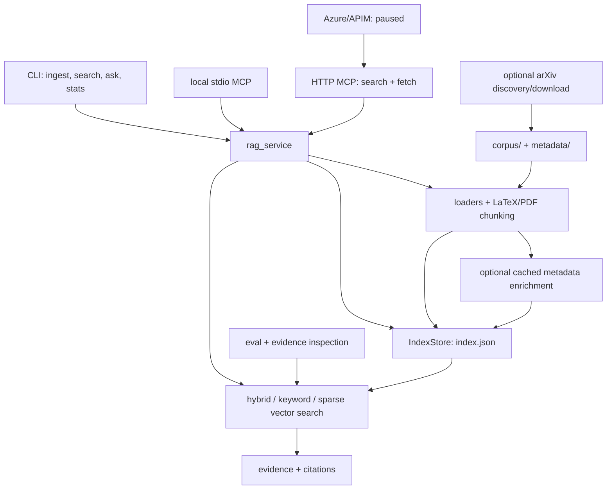

# Architecture

YTD_RAG is a local Python application with a file-based index. Its core is
**load documents → create chunks → save JSON → retrieve passages → cite them**.
Paper acquisition and MCP access are optional interfaces around that core.
There is no database server, model API, or background job required for local use.

## Data flow

## Responsibilities

All module names below are relative to `math_rag/src/math_rag/`.

| Layer | Modules | Responsibility |
| --- | --- | --- |
| Local interface | `cli.py` | One argparse entrypoint; commands call service or research tools |
| Service | `rag_service.py` | Ingest, retrieve, bounded search/answer payloads, chunk/source lookup, stats |
| Input | `loaders.py`, `latex_chunker.py`, `pdf_loader.py` | File selection, metadata, stable chunks and source locations |
| Data | `models.py`, `index_store.py`, `config.py` | Dataclasses, JSON schema version 1, shared settings |
| Retrieval | `hybrid_search.py`, `keyword_search.py`, `vector_search.py` | Ranking and keyword/sparse cosine retrieval |
| Search text | `text_cleaning.py`, `symbol_normalization.py` | Search-only normalization, symbols, aliases; source text stays intact |
| Evidence output | `answer.py`, `citations.py` | CLI report, confidence checks, source citations |
| Enrichment | `metadata_enrichment.py`, `metadata_enrichment_cache.py` | Optional deterministic or local JSONL metadata; no model API |
| Evaluation | `eval.py`, `evidence_eval.py` | Source hit rates and passage-level candidate inspection |
| Paper acquisition | `discovery.py`, `arxiv_client.py`, `paper_ranker.py`, `paper_store.py`, `downloader.py` | Discover, rank, review, download, record paper metadata |
| Local MCP | `mcp_server.py` | Stdio transport and workspace checks; read-only by default |
| Remote MCP | `mcp_http_server.py` | FastMCP HTTP transport, authentication, sanitized bounded results |

`remote_mcp_server.py` is the older HTTP adapter, retained for compatibility.
Azure's Dockerfile uses
`mcp_http_server.py`; new remote work should use that entrypoint. The two
adapters are not stacked on top of one another.

## Storage and configuration

- `corpus/` contains original user/research material. It is not application code.
- `metadata/documents.yaml` supplies optional document metadata. Discovery uses
  built-in defaults unless `--config FILE` selects a YAML configuration such as
  `metadata/discovery_config.yaml`. `research_profile.md` is a human reference.
- `.math_rag_index/index.json` stores `schema_version` and serialized `chunks`.
  It contains document text and may be private. `ingest` rebuilds it; it is not
  an append operation. Existing indexes require no migration for this cleanup.
- Enrichment cache lives under the chosen index directory. It can be rebuilt
  without changing source content or deterministic chunk boundaries.
- `discovered_papers.yaml` is a review queue. Candidate approvals and downloaded
  paper metadata are user data, not disposable build artifacts.
- `.math_rag_agent_logs_index/` is an optional separate engineering-memory index.
- CLI paths are relative to the working directory; pass `--index-dir` explicitly
  for a nondefault index. MCP supports `MATH_RAG_INDEX_DIR` and its documented
  workspace settings. Example `.env` files are references, not auto-loaded files.

The entire index is loaded for a retrieval call. Keyword and sparse vector
structures are built in memory; there is no persistent embedding service.
`--mode vector` still means deterministic sparse cosine search.
`MATH_RAG_EMBEDDING_BACKEND` is a retained compatibility setting, not a switch
to an implemented neural backend.

## Boundaries

The CLI and MCP interfaces reuse the service and retrieval modules. The CLI
formats text; MCP returns structured, capped payloads. Evaluation calls the
same ranking code directly so it can inspect full results across questions.

The core runtime dependency is PyYAML. Optional extras are `pdf` (pypdf),
`remote-mcp` (FastMCP/uvicorn), and `dev` (pytest). Models always use dataclasses;
installing remote dependencies does not change their implementation.

Local MCP exposes `rag_search`, `rag_ask`, `rag_get_chunk`, and
`rag_list_sources`. `rag_ingest` requires explicit write-tool enablement and
workspace-relative paths. HTTP MCP stays read-only; ChatGPT mode exposes only
`search` and `fetch`. arXiv/network acquisition is not exposed as an MCP tool.

Remote Azure serving was paused on 2026-05-18. The last recorded state is
preserved in the [pause report](agent_logs/codex/2026-05-18-remote-mcp-paused.md).
[Deployment gates](docs/azure_remote_mcp_readiness.md) distinguish fixture access
from private-index requirements. Historical `findings/` are engineering records,
not current operational instructions or mathematical evidence.

## Changes and checks

Change command wiring in `cli.py`, source handling in the input modules,
ranking in retrieval modules, and transport rules in the appropriate MCP
adapter. Keep transport code out of ranking and corpus parsing.

Run `python -m pytest math_rag/tests` using `math_rag/.venv/bin/python`.
For ranking/index changes, also run CLI `stats` and
`eval eval/toric_core_gold_questions.yaml`. Use temporary fixture indexes for
ingestion tests so the research index remains untouched.

Known limits: JSON is loaded in full, PDF/LaTeX extraction is heuristic, and
retrieved evidence does not establish proof correctness or novelty.
