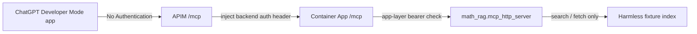
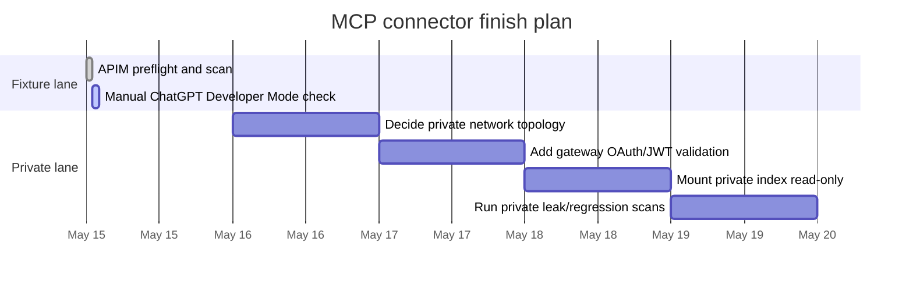

# Summary

> Historical snapshot. Remote MCP was last recorded as paused on 2026-05-18
> with Container App ingress disabled. Claims below describe their original
> inspection dates; live status has not been rechecked. See the
> [remote MCP guide](../docs/remote_mcp_server.md) before any future use.

Date: 2026-05-15

## Executive Summary

The math RAG MCP connector is ready for the harmless fixture ChatGPT Developer
Mode test through APIM. It is not production-ready for the private real index.

Current fixture endpoint:

```text
https://apim-math-rag-mcp-5d67a258.azure-api.net/mcp
```

Current deterministic status:

```text
SAFE_FOR_APIM_FIXTURE: yes
SAFE_FOR_CHATGPT_DEVELOPER_TEST: blocked pending manual UI transcript
SAFE_FOR_PRIVATE_REAL_INDEX: no
NOT_PRODUCTION_READY: yes
```

## Current vs Required

| Layer | Current state | Fixture/public-safe requirement | Private-index requirement |
| --- | --- | --- | --- |
| ChatGPT auth | No Authentication to APIM | acceptable for fixture/public-safe | OAuth 2.1 or equivalent |
| APIM policy | injects backend auth, rewrites to `/mcp` | sufficient | add JWT validation |
| Backend ingress | public Container App FQDN | acceptable only for fixture/public-safe | private/internal path |
| Tool surface | `search`, `fetch` | correct | keep same external surface |
| Data | harmless fixture index | correct | private index not mounted yet |

## Risk Matrix

| Risk | Current likelihood | Impact | Status | Mitigation |
| --- | --- | ---: | --- | --- |
| Direct backend bypass for private data | high | high | present | private/internal backend before private rollout |
| Wrong ChatGPT tool surface | low | medium | not observed | verify `tools/list` after every deploy |
| Path/secret leakage | medium | high | payload scan passes | scan every smoke artifact and transcript |
| No Auth used with private data | medium | high | not used for private index | OAuth/private lane only |
| APIM Consumption mistaken for isolation | medium | high | documented | network-capable APIM/private backend for private lane |

## Flow



## Timeline



## Final Status

The connector can be connected now for fixture-only testing. Do not connect the
private real index until backend bypass and OAuth/JWT validation are solved.

## Evidence Boundary

This summary is engineering memory only. Do not use it as mathematical theorem
evidence.
